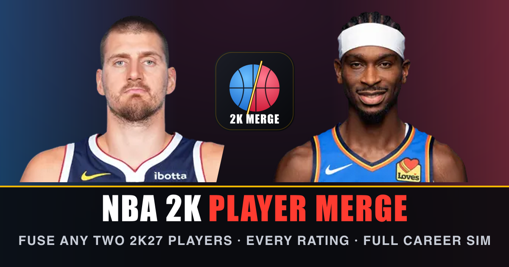

# NBA 2K Player Merge

Fuse any two NBA 2K27 players into one, see every rating, save them to a locker room and simulate a whole career.



## How the merge works

- **Name:** Player One's first name + Player Two's last name.
- **Height, weight, wingspan, age:** averaged.
- **Every attribute** (all 36 2K ratings, plus 18 body-part durability ratings): the merged player keeps whichever player's rating is higher.
- **Badges:** union of both players, keeping the higher tier.
- **Overall:** estimated from the merged attributes with per-position models fitted to all 653 real 2K27 overalls (non-negative weights, so a better rating never lowers the overall; durability carries no weight; mean error ≈ 1 point on real players). The "Why X OVR?" panel breaks down every point. The merged player plays whichever position his height allows and he rates best at.
- **Full Overall Sheet:** overall at every position (PG–C), the six category overalls, every attribute, body-part durability and badges.

## Career simulator

The full league (every 2K27 player, real rosters) is simulated each season: depth-chart minutes, stat lines, injuries rolled from body-part durability, standings, play-in and playoffs, MVP/All-NBA/All-Star/DPOY/6MOY/MIP voting, aging curves capped by potential, retirements, a 60-pick draft, contracts and free agency.

- Role players around 73–76 OVR can get waived mid-season, get only non-guaranteed or minimum offers, or fall out of the league entirely.
- 97+ superstars win MVPs and carry teams to 60+ wins.
- **95+ OVR unlocks Front Office Power:** choose which free agents your team signs, build trades for any player in the league, or force a trade to any team.

## Data

Ratings and headshots come from NBA 2K27 via [2kratings.com](https://www.2kratings.com) (30 NBA rosters + free agents, scraped October 2026) and live in `data/raw.json`. `npm run data` rebuilds `src/data/players.json` and the overall model; `node scripts/icons.mjs` regenerates the icon set and Open Graph image. 2K doesn't publish per-body-part durability on that site, so those 18 ratings are spread deterministically around each player's Overall Durability.

## Develop

```bash
npm install
npm run dev
```

Fan project — not affiliated with the NBA, 2K or Take-Two.
